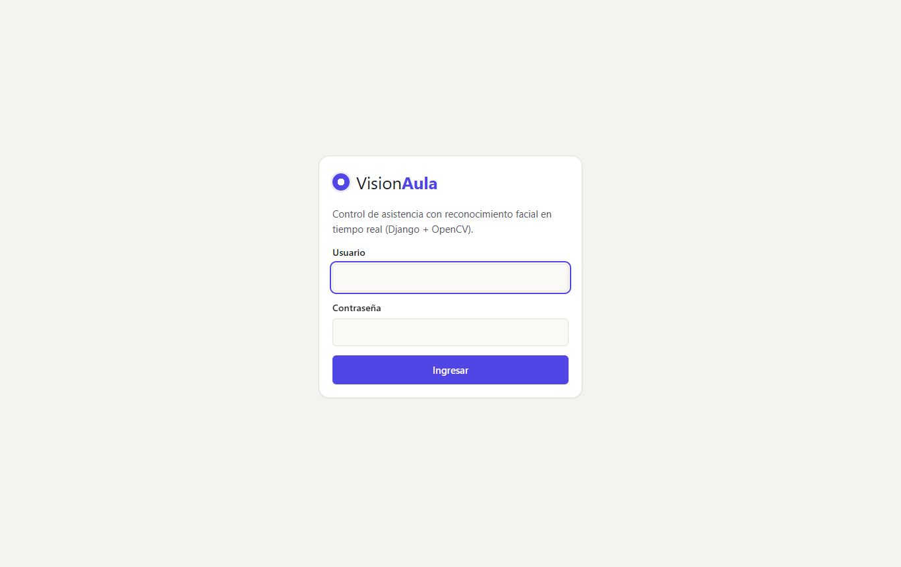
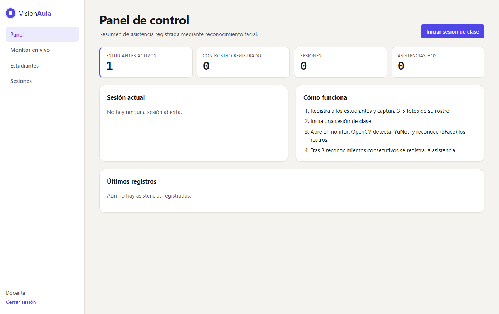
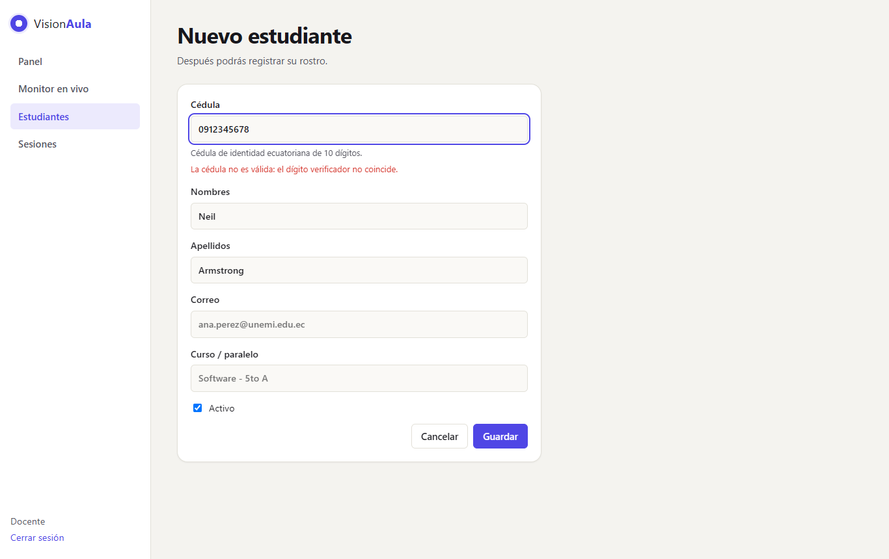
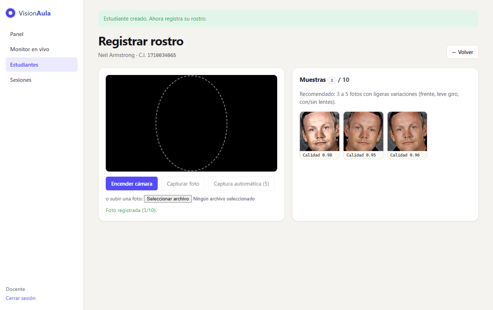
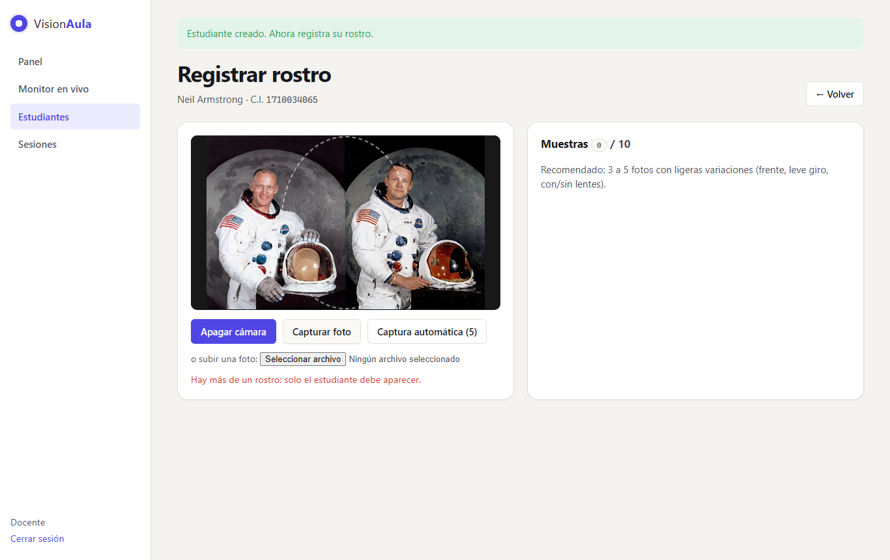
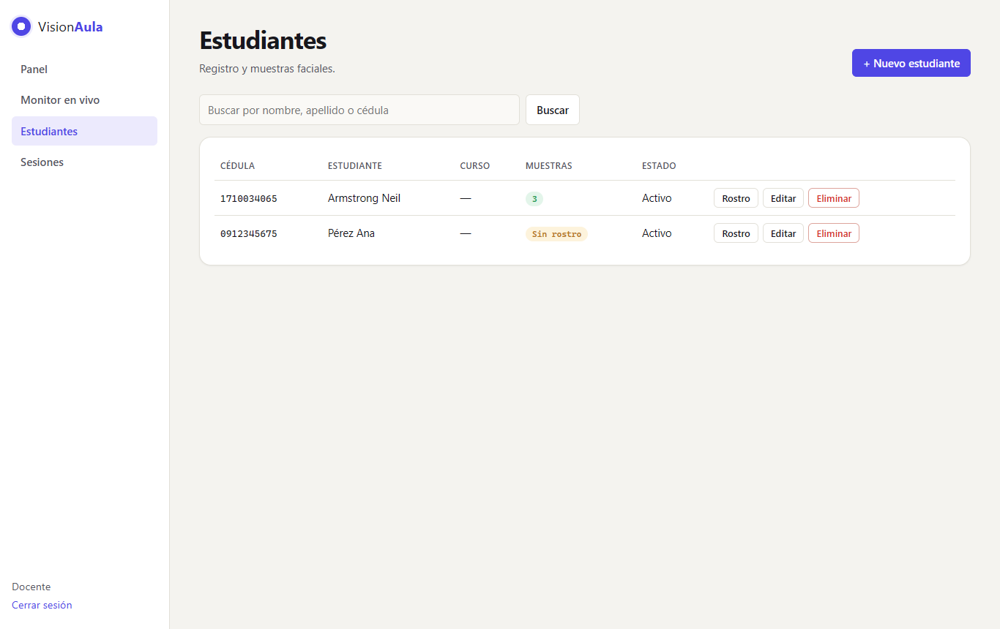
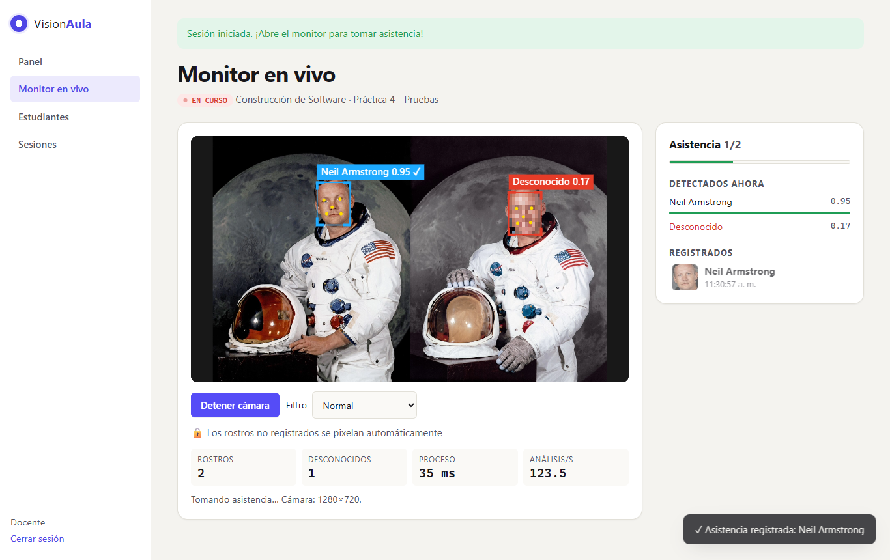
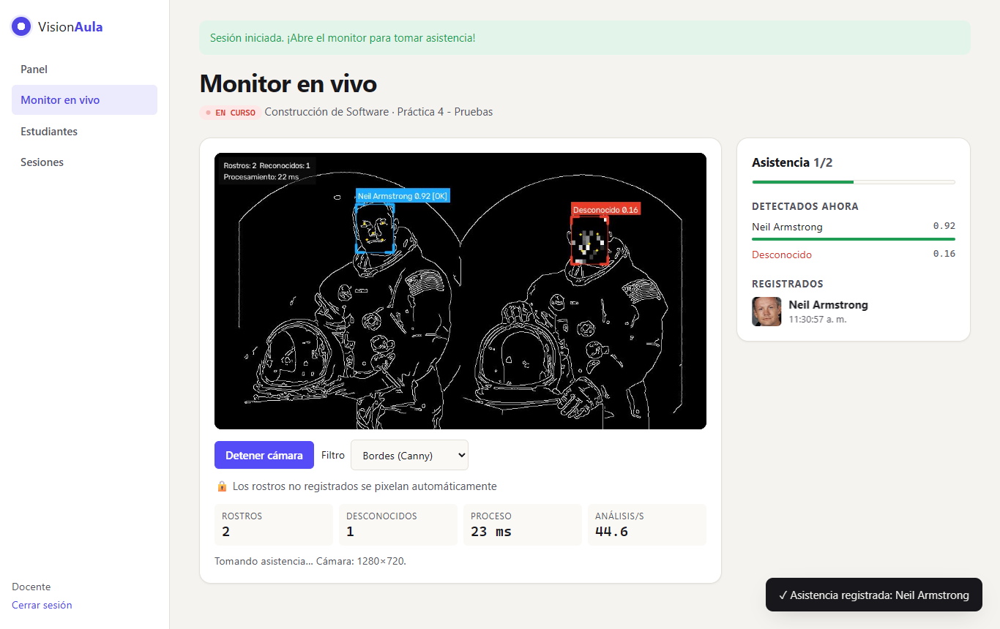
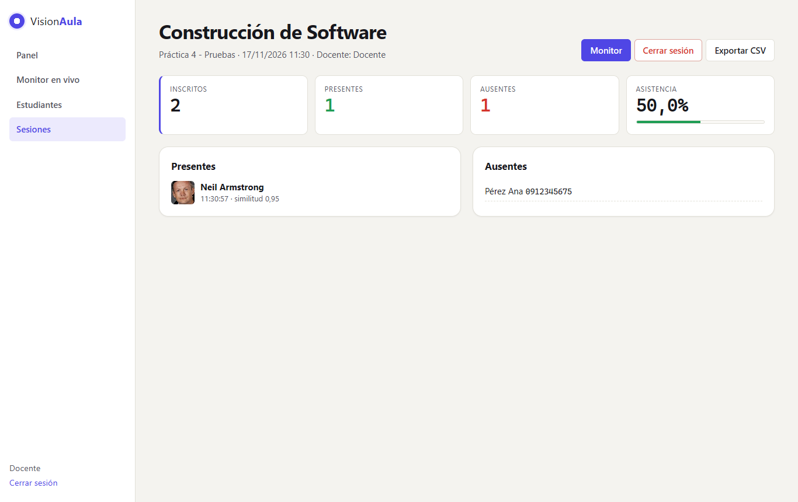

# Manual de usuario: VisionAula

VisionAula registra la asistencia de los estudiantes reconociendo su rostro con la cámara del
computador. Este manual está dirigido al **docente**.

> Las capturas se tomaron automáticamente durante las pruebas E2E. Como estudiante de ejemplo se
> usa el retrato oficial de Neil Armstrong (dominio público, NASA); Buzz Aldrin representa a una
> persona no registrada.

## 1. Iniciar sesión

1. Abra <http://localhost:8000> en Chrome, Edge o Firefox.
2. Escriba su **usuario** y **contraseña** y pulse **Ingresar**.

Si los datos son incorrectos, aparece el mensaje *"Usuario o contraseña incorrectos."*.
Todas las páginas exigen haber iniciado sesión.

## 2. Panel de control

Muestra el resumen del sistema: estudiantes activos, estudiantes con rostro registrado,
sesiones y asistencias del día, la sesión abierta y los últimos registros.
El menú lateral lleva a **Monitor en vivo**, **Estudiantes** y **Sesiones**.

## 3. Registrar un estudiante

1. Vaya a **Estudiantes → Nuevo estudiante**.
2. Escriba la **cédula** (10 dígitos), los nombres, los apellidos y, si desea, el correo y el curso.
3. Pulse **Guardar**.

La cédula se valida con el algoritmo del Registro Civil. Si no es válida se indica el motivo:

| Mensaje | Qué significa |
|---|---|
| "La cédula debe tener exactamente 10 dígitos numéricos." | Faltan o sobran dígitos, o hay letras |
| "Los dos primeros dígitos no corresponden a una provincia…" | El código de provincia no existe (01-24 o 30) |
| "El tercer dígito debe ser menor que 6…" | No es cédula de persona natural |
| "La cédula no es válida: el dígito verificador no coincide." | El último dígito no corresponde |
| "Ya existe un estudiante registrado con esta cédula." | La cédula está repetida |

## 4. Registrar el rostro del estudiante

Al guardar al estudiante se abre la página **Registrar rostro**. Se recomiendan de **3 a 5 fotos**
con ligeras variaciones (de frente, girando un poco la cabeza, con o sin lentes).

- **Encender cámara → Capturar foto:** toma una foto.
- **Captura automática (5):** toma 5 fotos seguidas; gire la cabeza levemente entre cada una.
- **Subir una foto:** elija un archivo JPG o PNG con el rostro del estudiante.

Cada foto aceptada aparece en **Muestras** con su puntaje de **calidad** (0 a 1).

El sistema rechaza las fotos que no sirven y explica por qué:

| Mensaje | Solución |
|---|---|
| "No se detectó ningún rostro." | Ubique el rostro dentro del óvalo |
| "Hay más de un rostro: solo el estudiante debe aparecer." | Que nadie más aparezca en la imagen |
| "Imagen borrosa: mantén la cabeza quieta." | No moverse al capturar |
| "Rostro muy oscuro…" / "Rostro sobreexpuesto…" | Mejorar la luz / evitar la luz directa |

En **Estudiantes** se ve la lista con el número de fotos de cada uno; se puede buscar por nombre o
cédula, editar o eliminar (al eliminar se borran también sus fotos).

## 5. Iniciar una sesión de clase

1. Vaya a **Sesiones**.
2. Escriba la **asignatura** y, opcionalmente, el **tema**.
3. Pulse **Iniciar sesión**. Se abre el monitor con la etiqueta **EN CURSO**.

Solo puede haber **una sesión abierta** a la vez; para abrir otra, cierre la actual.

## 6. Tomar asistencia con el monitor en vivo

1. Pulse **Iniciar cámara** y acepte el permiso de cámara del navegador.
2. Los estudiantes deben mirar a la cámara aproximadamente **1 segundo**.

**Cómo interpretar los resultados**

| Elemento | Significado |
|---|---|
| Marco **verde** con nombre y número | Estudiante reconocido; el número es la **similitud** (0 a 1, se reconoce desde 0.40) |
| Marco **azul** con ✓ / `[OK]` | Asistencia **ya registrada** en esta sesión |
| Marco **rojo** "Desconocido" y rostro **pixelado** | Persona no registrada: no se registra y su cara se oculta por privacidad |
| Puntos amarillos | 5 puntos faciales detectados (ojos, nariz, comisuras de la boca) |
| Barra bajo el nombre en *Detectados ahora* | Avance de la confirmación: al llegar al 100 % (3 reconocimientos) se registra |
| Lista **Registrados** y aviso "✓ Asistencia registrada" | Estudiantes presentes, con foto de evidencia y hora |
| **Asistencia 1/2** | Presentes / estudiantes activos |
| Rostros · Desconocidos · Proceso · Análisis/s | Rostros en imagen, no registrados, milisegundos por fotograma y análisis por segundo |

Un estudiante **no se registra dos veces** en la misma sesión. Si hay poca luz, el sistema muestra
*"Poca luz detectada: se aplica mejora de contraste (CLAHE)"* y sigue reconociendo.

### Filtros de procesamiento

En **Filtro** puede ver el video tal como lo procesa OpenCV en el servidor: Contraste (CLAHE),
Escala de grises, Bordes (Canny) y Mapa térmico. El reconocimiento y la asistencia continúan
funcionando con cualquier filtro.

> Sin una sesión abierta, el monitor reconoce rostros pero **no registra asistencia**.

## 7. Revisar, cerrar y exportar la sesión

En **Sesiones → Detalle** se muestran los inscritos, presentes, ausentes y el porcentaje de
asistencia, con la lista de presentes (foto, hora y similitud) y de ausentes.

- **Cerrar sesión:** termina la clase; ya no se registran más asistencias.
- **Exportar CSV:** descarga la lista (cédula, apellidos, nombres, Presente/Ausente, hora y
  similitud), lista para abrir en Excel.

## 8. Problemas frecuentes

| Problema | Solución |
|---|---|
| "Permiso de cámara denegado" | Habilite la cámara en el candado de la barra de direcciones y recargue |
| "No se encontró ninguna cámara" / "La cámara está siendo usada…" | Conecte una cámara o cierre Zoom/Teams |
| "Faltan los modelos de OpenCV" | Ejecute `python manage.py descargar_modelos` |
| "No hay rostros registrados" | Registre estudiantes con sus fotos (sección 4) |
| Un estudiante no es reconocido | Agregue más fotos con buena luz y de frente |
| "Sesión expirada: vuelva a iniciar sesión." | Inicie sesión de nuevo |
